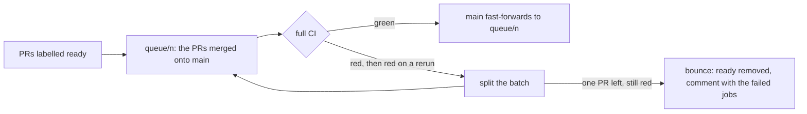

<p align="center"></p>

# qlander

Pronounced "Q-lander", from queue + lander.

A self-hosted merge queue for GitHub: it batches ready PRs, runs your full CI once per batch, fast-forwards `main` to the exact commit that passed, and sends back only the PR that broke it.

Apart from an emergency merge by a person you name as a ruleset bypass, `main` only ever points at a commit whose full suite passed.

You label a PR `ready`, and your CI runs on a `queue/` branch.



A bounced PR loses `ready` and gets a comment linking the failed jobs, and the other PRs in its batch land without it.

## What it guarantees

- Qlander moves `main` with a compare-and-swap, never a force push.
- A PR that changes your CI needs an approval from an account you list as an approver, naming its exact head SHA, unless a trusted bot's narrow waiver covers it. Keep those accounts to people: qlander can check the account, not who is using it. The PR lands alone, or, if you opt in, with other approved CI-policy PRs.
- Qlander never checks out or runs code from your repo. It works only through the GitHub API.
- Every CI run comes out of a budget, so a broken batch can't loop.

Qlander runs from a separate **control repo** that you own. A scheduled workflow there runs short jobs, one tick at a time. It uses GitHub Apps for the queue and its state, plus one for release advance if you enable it. Only the queue App, and any break-glass person you name on the ruleset, can move your `main`.

## Why not GitHub's merge queue?

Qlander runs one CI build per batch instead of one per queued PR, finds a failing PR by rerunning and splitting the batch, and pauses when a run passes qlander's time limits instead of removing a PR (a job's own `timeout-minutes` still counts as a failure). It also requires an approval bound to the SHA of a PR that changes CI. In exchange, you run it yourself, and it lands merge commits only.

You can't use both: qlander's audit requires GitHub's merge queue to be off on `main`. See the [full comparison](docs/vs-github-merge-queue.md).

## Quickstart

You need an organization that owns your repo, and the [GitHub CLI](https://cli.github.com) signed in as its owner. [Getting started](docs/getting-started.md) has every step. These are the main commands:

```sh
# Create the control repo. It must be at least as private as your repo.
gh repo create <owner>/<repo>-qlander --private --template brett/qlander-template --clone
cd <repo>-qlander

# Install Bun and download the pinned release into $bundle: see Getting started.
# Edit the CHANGE ME values in qlander.yml, then render the workflows and commit both.
bun "${bundle:?}" validate --config qlander.yml
bun "${bundle:?}" render --config qlander.yml

# On your own machine. Setup prints every change and writes nothing without --apply.
bun "${bundle:?}" setup --keys-dir ~/app-keys --config qlander.yml
bun "${bundle:?}" setup --keys-dir ~/app-keys --config qlander.yml --apply
bun "${bundle:?}" setup --keys-dir ~/app-keys --config qlander.yml --apply --step target --apply-target-rulesets

# Fix every FAIL before you go on.
GH_TOKEN=$(gh auth token) bun "${bundle:?}" audit --config qlander.yml
```

Then run the [rollout gates](docs/getting-started.md#10-roll-out): a sandbox check, then at least a day of dry runs with the repo variable `QLANDER_MODE` unset. Set it to `live`. To land a PR, wait for its fast-lane check to pass, then add `ready`.

## Configuration

`qlander.yml` names everything qlander acts on. You change these keys first, and the template fills in the rest:

```yaml
control:
  repo: acme/widgets-qlander      # this control repo
  repoId: 2001
target:
  repo: acme/widgets              # the repo whose main you land on
  repoId: 2002
queue:
  admission:
    fastLane:                     # the PR check that must pass before ready counts
      workflow: .github/workflows/ci.yml
      event: pull_request
      job: fast
  policy:
    paths:                        # PRs touching these land alone, with an approval
      - .github/**
    approvers:
      - login: alice
        id: 1001
  preLanding:                     # the full suite a batch must pass
    - path: .github/workflows/ci.yml
      name: CI
      when: always
      required_jobs:
        - test
      allow_skipped_jobs: {}
```

The [configuration reference](docs/configuration.md) lists every key with its default.

## Documentation

- [Getting started](docs/getting-started.md): set up the Apps, the control repo, the runners and the target, then roll out.
- [Using it with coding agents](docs/getting-started.md#using-it-with-coding-agents): the agent guides, and rules to copy into your target repo.
- [Qlander and GitHub's merge queue](docs/vs-github-merge-queue.md): the two compared, with sources.
- [How it works](docs/how-it-works.md): batching, bisection, CI-policy PRs, concurrency, strategies and release advance.
- [Operating it](docs/operating.md): pausing, labels, the command line, the status issue, alerts and runbooks.
- [Configuration](docs/configuration.md): every key in `qlander.yml`.
- [Hooks](docs/hooks.md): queue events sent to your repo as `repository_dispatch`.
- [Deployment and security](docs/deployment.md): the runner contract, the audit checks, packaging and upgrades.
- [Changelog](CHANGELOG.md): what changed in each release.
- [Design](DESIGN.md): the invariants, the state machine and every failure mode.
- [Qualification manifest](docs/qualification-manifest.md): the format release advance reads.

## Status and support

Qlander is pre-1.0 (v0.2). It supports both runner modes, self-hosted and GitHub-hosted. Before 1.0, stop the queue before every upgrade ([quiesce](docs/operating.md#quiesce)).

Support is best effort: issues are welcome, but there are no guaranteed response or fix times. Report security problems privately, as [SECURITY.md](SECURITY.md) says, never in an issue. To contribute, see [CONTRIBUTING.md](CONTRIBUTING.md).

## Licence

Public domain, under the [Unlicense](LICENSE). Contributions are accepted on the same terms.
